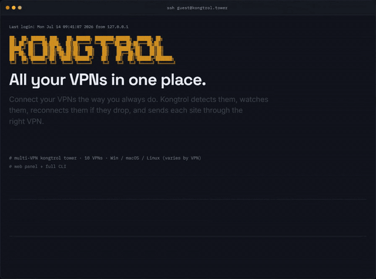
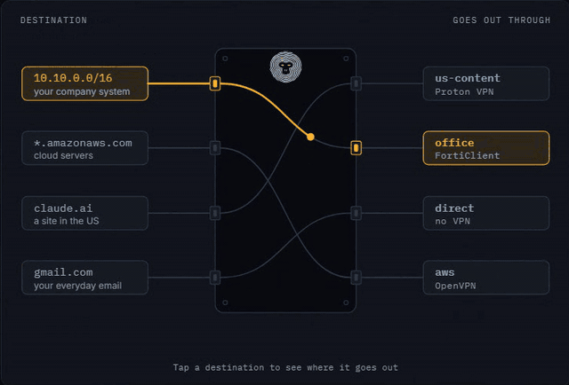
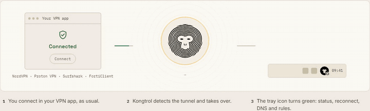

<!-- README version 2.2.0 · 2026-11-19.
     Theme-aware logo: GitHub supports <picture> with prefers-color-scheme sources
     (docs.github.com/en/get-started/writing-on-github/getting-started-with-writing-and-formatting-on-github/quickstart-for-writing-on-github#adding-an-image-to-suit-your-visitors). -->
<picture>
  <source media="(prefers-color-scheme: dark)" srcset="assets/brand/logo-kong-on-dark.svg" />
  <source media="(prefers-color-scheme: light)" srcset="assets/brand/logo-kong.svg" />
  
</picture>

# Kongtrol

**Your VPNs under control.** Connect your VPNs the way you always do. Kongtrol watches them,
reconnects them if they drop, and sends each site through the right one.

<sub>The program you install is <code>kongtrol</code> (formerly "VPN Kongtrol"). Public beta · README v2.2.0 · 2026-11-19.</sub>

<br clear="left" />

<div align="center">
  <p>
    
    
    
  </p>

  <p><a href="https://kongtrol.app/en/"><strong>kongtrol.app</strong></a> ·
  <a href="https://kongtrol.app/en/guide">Setup guide</a> ·
  <a href="https://github.com/DerotLuna/vpn-kongtrol/releases/latest">Download</a> ·
  <a href="https://kongtrol.app">Español</a></p>
</div>

<p align="center">
  
  <br/><sub><em>One command, three tunnels up, protection on. Recorded from <a href="https://kongtrol.app/en/">kongtrol.app</a>.</em></sub>
</p>

## What it is

Kongtrol runs several VPNs at once on the same computer and keeps them from fighting over routes
and DNS. **If you are not technical:** keep using your VPN apps (NordVPN, Proton VPN, Surfshark,
FortiClient…) as always; Kongtrol notices the connection, shows it in the tray and the browser
panel, reconnects it if it drops and protects you while it is down, with no terminal. **If you are
a developer or SRE:** reach client networks, WireGuard, OpenVPN, Tailscale or Cloudflare WARP at the
same time, send each destination (IP range or domain) through the right tunnel, and automate it all
from a CLI with the same features as the app. Free, open source, no account, and it never sends
your data anywhere.

## What's new

**v0.6.0 (pre-release, [v0.6.0-rc.3](https://github.com/DerotLuna/vpn-kongtrol/releases/tag/v0.6.0-rc.3)):**

- **Desktop app, no terminal needed:** Windows installer, macOS app, `.deb`/`.rpm` packages and a
  tray icon. On first run the browser panel opens to create your first VPN.
- **Diagnostics and export in the panel:** check your computer, repair the network helper and
  download your configuration (without passwords).
- **WireGuard shows "no answer from the server"** when a tunnel stops getting replies, instead of
  looking connected.
- **Clean uninstall** (`kongtrol uninstall`, `--purge` to also delete your data) and an **optional
  new version notice** (off by default).
- **Clearer commands** ([ADR-0033](docs/adr/0033-cli-command-restructure.md)): `policy list` /
  `policy show`, `ip`, `routes --system`, `config default-group`, `config killswitch` and
  `config dns-guard`, `reload [profile]`; `kongtrol init` offers to install the network helper.

**v0.5.0 (current release):** 10 VPNs (NordVPN and Surfshark joined), attach mode for VPN apps, and
Kongtrol keeps running in the background after you close the window.

<!-- feature:killswitch feature:dns_guard feature:watchdog -->
## Features

<p align="center">
  
  <br/><sub><em>Each destination, its rule, its tunnel. Recorded from <a href="https://kongtrol.app/en/#map">kongtrol.app</a>.</em></sub>
</p>

- **Several VPNs at once.** Each one keeps its own routes and DNS; Kongtrol settles the conflicts.
- **Routing per destination.** Rules by IP range or domain send traffic through the tunnel you
  choose, on every VPN type. `on_tunnel_down` decides what happens when that tunnel is off
  (normal internet by default, or block). App rules only explain and diagnose for now; they don't
  route per process yet.
- **Auto-reconnect.** The watchdog retries only the tunnel that dropped, with growing waits, and
  tells you when it can't. It fails over only to backups you declared (`failover:`); it never
  brings up an unrelated VPN. A provider app it cannot reconnect on its own gets a notice to
  reconnect it there.
- **Kill switch and DNS guard** at the system firewall and network level (`status` shows what is
  blocked and the DNS servers in use), with a signed local audit
  log whose signatures are checked when you read it. Turn them on in the panel or with `kongtrol config killswitch|dns-guard on|off|status`
  <sub>(command since v0.6.0, pre-release)</sub>.
- **Browser panel and tray icon.** One panel (the tray or `kongtrol dashboard` opens it) with seven sections: Home, Profiles (and groups), Rules (and schedules), Traffic, Security, Activity (audit log and notices), Settings
  (diagnostics, export, updates); compiled into the program, no external server. Tray icon
  <sub>since v0.6.0 (pre-release)</sub>.
- **Setup wizard** (`kongtrol init`): finds the VPN clients you have and saves passwords in the
  system keychain.
- **Diagnostics** (`kongtrol doctor`): checks programs, certificates, keychain and permissions
  before you connect, and says how to fix each problem.
- **No administrator terminal.** Network changes go through a small helper you install once.

Full status of every feature: [docs/ROADMAP.md](docs/ROADMAP.md).

<!-- feature:providers -->
## Supported VPNs

<p align="center">
  
  <br/><sub><em>You connect in your VPN app as usual; Kongtrol detects the tunnel and takes over. Recorded from <a href="https://kongtrol.app/en/#start">kongtrol.app</a>.</em></sub>
</p>

**You connect in the app, Kongtrol attaches.** Kongtrol detects the tunnel and handles status,
reconnection, DNS and rules. *auto* = Kongtrol can also connect it for you; *manual* = you connect
in the app, Kongtrol watches it.

| VPN | `type` | Windows | macOS | Linux |
|---|---|---|---|---|
| NordVPN | `nordvpn` | auto | manual | auto |
| Proton VPN | `protonvpn` | manual | manual | auto |
| Surfshark | `surfshark` | manual | manual | manual |
| FortiClient ([support by version](docs/forticlient-support.md)) | `forticlient` | auto | yes | yes |

**Kongtrol connects directly** with your config file or the official client.

| VPN | `type` | Windows | macOS | Linux |
|---|---|---|---|---|
| WireGuard | `wireguard` | yes | yes | yes |
| OpenVPN | `openvpn` | yes | partial¹ | yes |
| Tailscale | `tailscale` | yes | yes | yes |
| Cloudflare WARP | `cloudflarewarp` | yes | yes | yes |
| Cisco AnyConnect / Secure Client | `ciscoanyconnect` | yes | yes | yes |
| GlobalProtect | `globalprotect` | yes | yes | no |

¹ OpenVPN on macOS needs, for now, to run as administrator.
Proton VPN also works without its app as `type: wireguard` / `type: openvpn` with the files it lets you download.

<sub>Names are trademarks of their respective owners. Kongtrol is an independent project, not affiliated with them.</sub>

<!-- feature:distribution -->
## Install

**Current release (v0.5.0): the `kongtrol` program, one line.**

```bash
# macOS / Linux
curl -fsSL https://raw.githubusercontent.com/DerotLuna/vpn-kongtrol/v0.5.0/install.sh | sh
```

```powershell
# Windows (PowerShell)
iwr https://raw.githubusercontent.com/DerotLuna/vpn-kongtrol/v0.5.0/install.ps1 -useb | iex
```

Or download the file for your system from [Releases](https://github.com/DerotLuna/vpn-kongtrol/releases/latest).

**Desktop app — since v0.6.0 (pre-release).** To try it before the final release, download from
[v0.6.0-rc.3](https://github.com/DerotLuna/vpn-kongtrol/releases/tag/v0.6.0-rc.3):

| System | File |
|---|---|
| Windows | `Kongtrol-Setup-windows-amd64.exe` — per user, no admin; asks once to install the network helper. `kongtrol-windows-amd64.exe` is only the terminal command (a double click shows where to get the installer) |
| macOS | `Kongtrol-macos-universal.zip` — the app is not notarized (Apple charges $99/year): open it once with right-click › Open |
| Linux | `.deb` / `.rpm` for amd64 and arm64 |

Package managers (winget, Scoop, Homebrew, AUR, npm) are not published yet.

> **No administrator terminal.** Routing, DNS and firewall changes go through a small network
> helper (a system service) installed once: `kongtrol service install`. Your system asks for
> permission that one time. Since v0.6.0 (pre-release) the Windows installer, `kongtrol init` and
> `kongtrol up` offer it for you.

> **Antivirus or SmartScreen warning?** Windows files are not signed yet (the free SignPath
> Foundation application is pending), and programs that change routes, DNS and firewall get
> flagged on sight. It is a known false positive. Check the download
> ([checksums, Sigstore, build provenance](docs/SECURITY.md#verifying-releases)) or build from
> source. More in [docs/SECURITY.md](docs/SECURITY.md#unsigned-binaries-and-antivirus-false-positives).

Build from source (Go 1.27+): `git clone https://github.com/DerotLuna/vpn-kongtrol && cd vpn-kongtrol && make build`
(output: `build/dist/kongtrol`). More in [docs/DEVELOPMENT.md](docs/DEVELOPMENT.md).

<!-- feature:first_run -->
## First run

**With the app** <sub>since v0.6.0 (pre-release)</sub>: open Kongtrol. The panel opens in your
browser to create your first VPN ("Set up now…" in the tray icon opens it again). Kongtrol
restarts on its own once the VPN is saved.

**From the terminal** (same features):

```bash
kongtrol init           # wizard: finds your VPN clients, saves passwords in the keychain
kongtrol up office      # connect a profile (or: --group work, --all)
kongtrol status         # see each tunnel's state, IP and traffic
kongtrol dashboard      # open the panel in your browser (already signed in)
```

Step-by-step guide: [kongtrol.app/en/guide](https://kongtrol.app/en/guide)
(Español: [kongtrol.app/guia](https://kongtrol.app/guia)). Several VPNs, groups and rules:
[docs/SETUP.md](docs/SETUP.md).

## Daily use

- Kongtrol keeps working in the background (the "daemon": the Kongtrol process that stays on after
  you close the terminal, the tray or the panel). Closing a window **never** disconnects.
- Only `kongtrol down` or the tray's "Quit and disconnect all" disconnects your VPNs; "Close icon
  (VPNs keep running)" only hides the tray icon.
- Edited `kongtrol.yaml`? `kongtrol reload` applies it without disconnecting. Added a profile?
  `kongtrol restart` (or Restart in the panel).
- Something wrong? `kongtrol doctor`, then `kongtrol logs`.

## Commands

`kongtrol --help` lists every command by group, in English or Spanish; `kongtrol <command> --help`
explains it with the next step and examples. Full reference: [docs/CLI.en.md](docs/CLI.en.md)
(Español: [docs/CLI.md](docs/CLI.md)).

| Command | What it does | In v0.5.0 |
|---|---|---|
| `kongtrol up [profile…]` | Connect profiles (`--group`, `--all`, `--fav`) and open the live view | same |
| `kongtrol down [profile…]` | Disconnect profiles (`--group`, `--all`) | same |
| `kongtrol status [-w]` | State, IP and traffic of each tunnel | same |
| `kongtrol routes [profile] [--system]` | What goes through each tunnel; `--system`: routes Kongtrol added | `--system` was `routes list` |
| `kongtrol dashboard` | Open the panel in your browser | same |
| `kongtrol init` | Setup wizard | same |
| `kongtrol policy list` | Which VPN each rule uses | `map` |
| `kongtrol policy show <target\|app:<exe>>` | Which VPN a destination or app uses, and why | `policy explain` |
| `kongtrol policy test <file>` | Test your rules against a list of destinations | same |
| `kongtrol config validate` | Check `kongtrol.yaml` without connecting | same |
| `kongtrol config default-group [group]` | Show or set the group `kongtrol up` connects | `config defaults set-group` |
| `kongtrol config killswitch\|dns-guard <on\|off\|status>` | Kill switch and DNS guard | since v0.6.0 |
| `kongtrol config public-ip <on\|off>` | Optional public IP lookup | same |
| `kongtrol config update-check <on\|off\|status>` | Optional new version notice | since v0.6.0 |
| `kongtrol config lang <es\|en>` · `config favorites` · `config dashboard` | Language, favorites, panel address on this computer | same |
| `kongtrol reload [profile]` | Apply `kongtrol.yaml` changes without disconnecting | without `[profile]` |
| `kongtrol restart` | Restart Kongtrol and reconnect what was connected | since v0.6.0 |
| `kongtrol export` | Print your config without passwords to share it | same |
| `kongtrol doctor [--fix]` | Check your computer and say how to fix each problem | same |
| `kongtrol ip` | Look up your public IP now and check for leaks | `check` |
| `kongtrol logs` | Show Kongtrol's events | same |
| `kongtrol service install\|uninstall\|status` | Network helper (no admin terminal) | same |
| `kongtrol uninstall [--purge\|--data-only]` | Uninstall Kongtrol (your data stays unless you ask) | since v0.6.0 |
| `kongtrol version` | Show the version | same |

"since v0.6.0" = available in the [pre-release](https://github.com/DerotLuna/vpn-kongtrol/releases/tag/v0.6.0-rc.3), not in v0.5.0.

## Privacy: local only

Kongtrol sends no telemetry, analytics or crash reports. The panel, the tray and the CLI talk to
Kongtrol on your own computer (`127.0.0.1`); nothing leaves it. Passwords live in your system
keychain, never in files. Only two calls go outside, both **off by default**:

- **Public IP check** (`kongtrol config public-ip on`): asks `api.ipify.org` (or the service you
  choose) for your public IP after a tunnel connects or disconnects, and when you ask. That service
  sees your IP.
- **New version notice** <sub>since v0.6.0 (pre-release)</sub> (`kongtrol config update-check on`):
  asks api.github.com at most once a day. GitHub sees your IP and `kongtrol/<version>`.

Every connection Kongtrol makes: [docs/SECURITY.md](docs/SECURITY.md#network-connections-kongtrol-makes).
Privacy policy: [kongtrol.app/en/privacy](https://kongtrol.app/en/privacy).

<!-- feature:update_check -->
## Updating

Install the new version the same way you installed it: run the one-line script or the Windows
installer again, or install the new `.deb`/`.rpm`. Your settings in `~/.kongtrol`, passwords in the
keychain and the network helper stay. If you already have it, the Windows installer and the
scripts detect it and say "Update Kongtrol <old> → <new>" (or reinstall, or warn before an older
version) without asking again what you already chose; the helper asks for permission only if it
is out of date. Then run `kongtrol restart` (or Restart in the panel) to
switch to the new version with your VPNs reconnected. The new version notice
<sub>since v0.6.0 (pre-release)</sub> is off by default: turn it on in the panel (Settings) or with
`kongtrol config update-check on`. It never downloads or installs anything.

<!-- feature:uninstall -->
## Uninstalling <sub>since v0.6.0 (pre-release)</sub>

Your settings and saved passwords **stay** unless you ask, so a reinstall brings everything back.
Windows: Settings › Apps › Kongtrol › Uninstall (it asks whether to delete your data; default No).
Elsewhere: `kongtrol uninstall` (`--purge` also deletes `~/.kongtrol` and the saved passwords,
`--dry-run` shows the plan). To only wipe your data and keep the app: panel › Settings › "Delete all
my data", or `kongtrol uninstall --data-only`. In v0.5.0, delete the `kongtrol` file and run
`kongtrol service uninstall` first.

## Documentation

| Doc | Covers |
|---|---|
| [Setup guide](https://kongtrol.app/en/guide) · [ES](https://kongtrol.app/guia) | Install and first VPN, step by step |
| [docs/SETUP.md](docs/SETUP.md) | Guided walkthrough: several VPNs, groups, rules |
| [docs/CLI.en.md](docs/CLI.en.md) · [ES](docs/CLI.md) | Every command and flag (generated from the CLI) |
| [docs/CONFIG.en.md](docs/CONFIG.en.md) · [ES](docs/CONFIG.md) | Every `kongtrol.yaml` key with type and default (generated from the schema) |
| [docs/CONFIGURATION.md](docs/CONFIGURATION.md) | `kongtrol.yaml` guide with examples |
| [docs/SECURITY.md](docs/SECURITY.md) | Network connections, network helper, kill switch, DNS guard, recovery |
| [docs/API.md](docs/API.md) | Local API used by the tray and the panel |
| [docs/ARCHITECTURE.md](docs/ARCHITECTURE.md) | System design, project layout, adding a VPN adapter |
| [docs/DOCKER.md](docs/DOCKER.md) | Headless / server use |
| [docs/ROADMAP.md](docs/ROADMAP.md) | Feature status and roadmap |
| [docs/adr/](docs/adr/README.md) · [docs/research/](docs/research/README.md) | Decisions and the research behind them |

## Security

Found a vulnerability? Please report it privately as described in [SECURITY.md](SECURITY.md)
(supported versions, scope). Summary for users: [kongtrol.app/en/security](https://kongtrol.app/en/security).

## Contributing

Build, test, lint, docs and release commands are in [docs/DEVELOPMENT.md](docs/DEVELOPMENT.md);
rules for contributors (and coding agents) are in [AGENTS.md](AGENTS.md). The GIFs in this README
are recorded from the landing page: `node scripts/readme-media.mjs`.

## License

Apache License 2.0 — see [LICENSE](LICENSE). Terms of use: [kongtrol.app/en/terms](https://kongtrol.app/en/terms).
